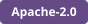

<h1 align="center">KODA BOM Kit</h1>

<!-- koda-doc-nav -->
<p align="center">
  <a href="../README.md"></a>
  <a href="README.ja.md"></a>
  <a href="README.zh.md"></a>
  <a href="README.zh-hant.md"></a>
  <strong>한국어</strong>
  <a href="README.es.md"></a>
  <a href="README.fr.md"></a>
  <a href="README.vi.md"></a>
  <a href="README.pt.md"></a>
  <a href="README.th.md"></a>
  <a href="README.tr.md"></a>
</p>
<p align="center">
  <a href="https://github.com/jhny-kor/KODA-BOM-Kit/releases/tag/v0.1.8"></a>
  <a href="../LICENSE"></a>
  <a href="support-matrix.ko.md"></a>
</p>
<!-- /koda-doc-nav -->

<p align="center"><strong>폐쇄망 Linux 서버에서 실행 파일 하나로 소프트웨어, 하드웨어와 운영 정보를 수집합니다. KODA BOM Kit은 CycloneDX BOM 7종과 병합본, SPDX 소프트웨어 인벤토리를 생성합니다.</strong></p>

<p align="center">
  <a href="https://github.com/jhny-kor/KODA-BOM-Kit/releases/tag/v0.1.8"><b>v0.1.8 다운로드</b></a> ·
  원저자 <a href="https://github.com/jhny-kor">jhny-kor</a> ·
  <a href="https://github.com/jhny-kor/KODA-BOM-Kit">공식 저장소</a>
</p>

## 빠른 시작

Linux amd64용 압축파일과 이름이 일치하는 SHA-256 파일을 내려받아 대상 서버의 빈 디렉터리로 옮긴 뒤 아래 명령을 실행하세요. 대상 서버에 Go나 취약점 데이터베이스를 설치하거나 패키지를 내려받을 필요가 없습니다.

```sh
(
  set -eu
  set -- koda-bom-linux-amd64-0.1.8-*.tar.gz
  test "$#" -eq 1 && test -f "$1" || exit 1
  sha256sum -c "$1.sha256"
  tar -xzf "$1"
  cd "${1%.tar.gz}"
  sha256sum -c SHA256SUMS
  ./koda-bom version
  sudo ./koda-bom
)
```

## 수집 결과

마지막 줄에 `bom-output/` 아래에 생성된 디렉터리 경로가 표시됩니다. 병합본은 `bom.cdx.json`, 개별 BOM 7종은 `boms/`에 있습니다.

| 파일 | 기록 내용 |
|---|---|
| `boms/sbom.cdx.json` | 설치된 패키지·라이브러리·애플리케이션 |
| `boms/hbom.cdx.json` | 장치·펌웨어·드라이버 |
| `boms/cbom.cdx.json` | 인증서·알고리즘 등 암호 자산 |
| `boms/obom.cdx.json` | 서비스·프로세스·소켓·패키지 사이에서 관측된 관계 |
| `boms/aibom.cdx.json` | 로컬 모델 파일·가중치와 제공된 모델 메타데이터 |
| `boms/saasbom.cdx.json` | OpenAPI 문서나 서비스 명세에 정의된 서비스 |
| `boms/mbom.cdx.json` | 입력한 증적으로 확인되는 제조·빌드 공정 |

해당 호스트에서 증거를 찾지 못한 BOM은 항목이 비어 있을 수 있습니다. 개별 BOM의 증거 상태와 `collection.json`에서 사유를 확인하세요. Tracker에는 최상위의 `sbom.cdx.json` 또는 `sbom.spdx.json`을 제출합니다. 기본 출력 형식은 CycloneDX 1.6과 SPDX 2.3입니다. `--cyclonedx-17`을 추가하면 CycloneDX 1.7도 함께 생성합니다.

재병합하려면 매니페스트·관계·체크섬을 포함한 `boms/` 디렉터리 전체를 복사하세요. 아래 `run_dir`에는 수집기가 마지막에 출력한 경로를 넣습니다.

```sh
(
  cd koda-bom-linux-amd64-0.1.8-*/ || exit 1
  run_dir='/path/printed/by/koda-bom'
  ./koda-bom bom-merge --set "$run_dir/boms" --output-dir ./merged
)
```

## 문서

- [폐쇄망 반입·실행 및 결과 확인](air-gapped.ko.md)
- [수집 명령과 출력 파일](collector-guide.ko.md)
- [하드웨어·암호·운영 증적](asset-inventory.ko.md)
- [서비스·AI 모델·제조 공정 명세](additional-bom.ko.md)
- [지원 범위와 수집 한계](support-matrix.ko.md)
- [빌드와 검증 절차](verification.ko.md)
- [검증 결과와 시험 범위](검증결과.ko.md)

### 소스 및 시험 환경

- [외부 자산 반입](internal/assetimport/README.ko.md)
- [플랫폼 인벤토리](internal/platforminventory/README.ko.md)
- [제품 식별](internal/products/README.ko.md)
- [Oracle Linux VM](tests/oracle-vm/README.ko.md)
- [Ubuntu VM](tests/ubuntu-vm/README.ko.md)

## 라이선스와 저작자 표시

KODA BOM Kit의 라이선스는 Apache-2.0입니다. 원저자와 배포본에 포함된 외부 구성요소의 라이선스는 아래 문서에서 확인할 수 있습니다. [Apache-2.0](../LICENSE) · [원저자 고지](../NOTICE) · [외부 구성요소 고지](THIRD_PARTY_NOTICES.ko.md)
