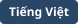

# ハードウェアとソフトウェアのインベントリ

<!-- koda-doc-nav -->
<p align="center">
  <a href="asset-inventory.md"></a>
  <strong>日本語</strong>
  <a href="asset-inventory.zh.md"></a>
  <a href="asset-inventory.zh-hant.md"></a>
  <a href="asset-inventory.ko.md"></a>
  <a href="asset-inventory.es.md"></a>
  <a href="asset-inventory.fr.md"></a>
  <a href="asset-inventory.vi.md"></a>
  <a href="asset-inventory.pt.md"></a>
  <a href="asset-inventory.th.md"></a>
  <a href="asset-inventory.tr.md"></a>
</p>
<p align="center">
  <a href="https://github.com/jhny-kor/KODA-BOM-Kit/releases/tag/v0.1.8"></a>
  <a href="../LICENSE"></a>
</p>
<!-- /koda-doc-nav -->


対象OS・CPU用の `koda-bom` を使います。Linuxの `scan` はパッケージとホスト機器を収集します。Windows/macOSの `platform-inventory` はOSのローカルインベントリツールを呼び出します。

```sh
./koda-bom scan --output-dir ./reports

./koda-bom scan --output-dir ./reports --asset-tag 'web-01'

./koda-bom scan --output-dir ./reports --cyclonedx-17

./koda-bom scan --asset-evidence ./bmc.json --asset-evidence ./nic.json --output-dir ./reports

./koda-bom asset-import --asset-evidence ./network-assets.json --output-dir ./reports

./koda-bom platform-inventory --output-dir ./reports
```

Windows PowerShellでは `.\koda-bom.exe platform-inventory --output-dir .\reports` を使います。Linuxのディレクトリ・イメージ収集は指定ファイルシステムが対象です。稼働中の機器情報はコンテキストを有効にしたホスト `/` で観測します。Docker/OCIアーカイブはLinux amd64に対応します。検証したCycloneDX文書をTrackerに登録し、両形式とチェックサムを同じ収集回として保管します。

## 収集する証拠

| 領域 | 収集内容と解釈 |
|---|---|
| ハードウェア | CPU・マイクロコード、緩和策、基板、BIOS/UEFI、ESRT、PCI・ドライバー、NVMe/SCSI、USB、TPM。RAID/HBAの `mpt3sas`、`qla2xxx`、`lpfc`、`hpsa`、`smartpqi`、RDMAの `fw_ver`、NVIDIA Video BIOS、amdgpuの `vbios_version`。NICは `ethtool -i` 相当の読取専用ioctl。megaraid_sasはエクスポート証拠が必要です。root実行時はSMBIOSの生テーブルから、メモリーモジュールの製造元・部品番号・容量・速度、電源ユニットのモデル・定格出力、システムスロットと装着PCIアドレスを読み、シリアル番号はSHA-256のみ記録します |
| BMC | rootと `ipmi_si`・`ipmi_devintf` により `/dev/ipmi0` の読取専用 `Get Device ID` を使用。ファームウェアリビジョン、IANAメーカー、製品ID、補助リビジョンを記録。取得できない理由も記録し、必要に応じRedfishで公開ビルド番号と照合します |
| CPU識別 | x86の `cpuidSignature`・`familyModelStepping`、ソケット・コア、ARMメーカー・コア名・`r3p1` 形式のリビジョン。不明なARMは元コードを保持。USBの `bcdDevice` はデバイスリリース識別子です |
| 外部資産 | 展開済みRedfish、fwupd、devlink JSONと共通形式。稼働中・保存済みファームウェアを区別し、項目は機種に依存します |
| 実行状態 | 実行ファイル・共有ライブラリの置換、ファイル識別子、一意に特定した所有パッケージ。置換は `restart_review`。メモリー上の版は追加証拠が必要です |
| ホスト識別 | ホスト `/` のmachine-id、DMI UUID・製品/基板シリアルの正規化SHA-256。`--no-context` でも取得。machine-id/UUIDは小文字、シリアルは前後空白を除去。共通初期値やゼロUUIDは除外。ハッシュは推測可能な仮名化です。`--asset-tag` は128文字以内の1行ラベル。コンテナーは `container-visible` |
| ソケット | 同じネットワーク名前空間のTCP LISTENと未接続UDPをプロセスFDから帰属。`bindScope` は `all-interfaces`、`loopback`、`address`。到達性は別証拠が必要。所有者不明は `context.json.unattributedSockets`。ホストのプロセスが確立した外部TCP接続は、プロセスと接続先ごとに `outboundConnections` へ `remoteScope`（`loopback`、`private`、`link-local`、`public`）付きで記録します |
| 設定・再起動 | SELinux実行/設定モード、AppArmor有効/プロファイル数、lockdown、FIPS、許可された起動引数。認証情報は除外。`kernelConfig` は `/proc/config.gz` または `/boot/config-<running-kernel>` の `y`・`m`。再起動要求、実行カーネルのモジュール欠落、同系統の新カーネルを観測し、信号があれば `reboot.recommended=true`、なければ `not_observed`。系統判定はリリース文字列による推定です |
| SSH | `sshd_config`・`sshd_config.d/*.conf` のグローバル宣言。`PermitRootLogin`、`PasswordAuthentication`、`PermitEmptyPasswords`、`KbdInteractiveAuthentication`、`LoginGraceTime`、`MaxStartups`、`X11Forwarding`、`AllowTcpForwarding`。`Match` は対象外で、実効値は `Include` 順序に依存します |
| モジュール・不明プログラム | `kernel.tainted`、`taintedModules` の名前・`O`/`E`/`P`・version/srcversion。同じrootで所有元不明の実行ファイルは `unidentifiedExecutables` にパス/PIDを記録。usr-mergeを考慮します |
| 整合性 | RPM/dpkg/apkのハッシュと実行ファイル・`.so` を比較。設定・ghostは除外。`modified`・`missing` は `collection.json.integrity.findings` と構成要素に記録。上限はホスト8 GiB、コンテナー1 GiBで、到達時は `partial`。prelinkで差異が出る場合があります |
| パッケージ出所 | apt Packagesの平文/gz/lz4は名前で照合。dnf履歴とyum `from_repo` はリポジトリID。`repository`、`local-file`、`not-recorded`。履歴欠落・dnf5・apkは対象外。URLとローカルパスは除外し、dnf DBは一時コピーを読取専用で開きます |
| 起動サービス | systemd wants/requires、unit/drop-in、最初の `ExecStart`、ソケット有効化、PURL。マスク済みを除外。`system.slice` のプロセスで稼働判定し、独自sliceは停止表示の場合があります。有効なタイマーは `On*` スケジュールと起動するサービスを記録します |
| ハードウェアCPE | Intel Xeon/Core、AMD EPYC/Ryzen、Dell PowerEdge機器/BIOS、Lenovo ThinkSystem機器の対応パターン。不明機種・HPE・BMCには推測したCPEを付けません |
| 証明書 | 公開X.509指紋、有効期間、アルゴリズム、鍵長、状態。SHA-1/MD5、2048ビット未満RSA、DSAを記録。古典暗号の `nistQuantumSecurityLevel=0`。主体/発行者名と秘密鍵は除外。OS信頼ストアと20証明書超の束は省略します。SSHホスト公開鍵（`etc/ssh/ssh_host_*_key.pub`）もOpenSSHのSHA-256指紋とともに記録します |
| アプリ | 有効snapと内包DEB、有効flatpak/AppStream、condaのチャネル名、`.pyz`/`.pex`、JAR、静的JS、Go/Rust。Docker/OCIのハッシュと検証できたダイジェストを保持します |

## コンテナーと出力

稼働コンテナーは `containers/<name>/` に個別収集します。Kubernetes名はnamespace・pod・containerを使い、重複時はID先頭12文字を追加。Docker/containerd/Podman/CRI-Oのディスク上の状態を読み、ランタイムAPIへは接続しません。mountinfoのデバイス番号でrootを特定し、イメージ・書込層を含め、volume/bind mountを除外します。ソケットは当該コンテナーのプロセスに帰属し、パッケージ所有を優先、Goはmain moduleを使います。root不可視・時間超過は理由付き `not_collected`。`--no-containers` で無効化します。

停止コンテナーと未使用イメージはDocker overlay2、containerd overlayfs（k3s/RKE2を含む）、rootful Podman/CRI-Oに対応します。層を出力先の一時領域にコピーしwhiteout/opaqueを適用、収集後削除します。デバイスとset-IDビットは複製しません。rootが16 GiB超、または空き容量がrootサイズ+1 GiB未満ならスキップ。`state: stopped` または `state: image` を記録し待受ソケットはありません。同時変更で取得不能になる場合があります。他のストレージドライバーとrootless Podmanは非対応。`--no-images` で無効化します。

既定では `boms/` の7種を `bom.cdx.json` に統合します。AI-BOMは `aibom.cdx.json`。互換出力はCycloneDX 1.6の `sbom.cdx.json` とSPDX 2.3の `sbom.spdx.json`。`--cyclonedx-17` で1.7を追加します。SPDXでは専用型のないものを `OTHER` と注釈で表します。ホストは `koda:host:*`、コンテナーは `koda:container:*`、ソケットは `koda:runtime:listening`・`koda:runtime:bind-scope`。`assets.json`、`context.json`、`collection.json`、`inventory.syft.json` を確認し、`SHA256SUMS` で検証します。

## 共通資産証拠

最大8ファイル、各8 MiBです。`parentId` は同じファイルの `id` を参照し、不明な版は省略します。RedfishはURI一覧を展開した機器・ファームウェアオブジェクトが必要です。入力SHA-256は取り込んだファイルを識別します。

```json
{
  "schema": "koda-assets-1",
  "observedAt": "2026-11-18T01:00:00Z",
  "assets": [
    {"id": "board", "kind": "device", "name": "Controller", "model": "Model-A"},
    {
      "id": "firmware",
      "parentId": "board",
      "kind": "firmware",
      "name": "Controller firmware",
      "version": "1.2",
      "properties": {"applicationState": "Active", "storedVersion": "1.3"}
    }
  ]
}
```

## 暗号資産とTLSセッション

証明書・公開鍵・アルゴリズムは `cryptographic-asset` です。発行者候補は署名を確認します。Nginx/Apache/sshdの許可された指示は設定証拠です。JKS v1/v2の公開チェーンと別名SHA-256を記録し、暗号化鍵は読み飛ばし、ストア整合性は `not-verified` とします。

PKCS#12/HSM/KMSの公開メタデータは `--asset-evidence` で取り込みます。`related-crypto-material` に鍵種別・サイズ・状態・`algorithmRef`、`properties.storageType`・`keyAlias` を記録できます。利用側の `dependsOn` は同ファイルの鍵メタデータを参照します。

別途計測したTLSネゴシエーションの例です。指紋・接続先・時刻を実測値に置き換えます。一致した証明書ハッシュでサービス→プロトコル→証明書を結びます。

```json
{
  "schema": "koda-assets-1",
  "observedAt": "2026-11-21T01:00:00Z",
  "assets": [
    {
      "id": "cert", "kind": "cryptographic-asset", "name": "Peer certificate",
      "sha256": "aaaaaaaaaaaaaaaaaaaaaaaaaaaaaaaaaaaaaaaaaaaaaaaaaaaaaaaaaaaaaaaa",
      "cryptoProperties": {"assetType": "certificate", "certificateProperties": {"certificateFormat": "X.509"}}
    },
    {
      "id": "session", "kind": "cryptographic-asset", "name": "TLS session",
      "cryptoProperties": {"assetType": "protocol", "protocolProperties": {
        "type": "tls", "version": "1.3", "cipherSuites": [{"name": "TLS_AES_256_GCM_SHA384"}]
      }},
      "properties": {
        "endpoint": "example.invalid:443", "transport": "tcp",
        "sessionObservedAt": "2026-11-21T01:00:00Z", "observationState": "negotiated",
        "certificateSHA256": "aaaaaaaaaaaaaaaaaaaaaaaaaaaaaaaaaaaaaaaaaaaaaaaaaaaaaaaaaaaaaaaa"
      }
    }
  ]
}
```

## オフラインの勧告照合

新しい勧告で保存済み収集を再評価できます。

```sh
./koda-bom assess \
  --sbom ./reports/COLLECTION/sbom.cdx.json \
  --context ./reports/COLLECTION/context.json \
  --advisories ./advisory-rules.json \
  --kev ./known_exploited_vulnerabilities.json \
  --output ./assessment.json
```

`--context`・`--kev` は任意です。コンテキスト指定時は同じ収集の `SHA256SUMS` でSBOMとcontextを検証します。KEVは優先度情報です。明示ルール、正確な影響版/PURLを持つOSV、正確な製品ID/無条件状態のCSAF 2.0に対応します。未対応範囲・条件・製品組合せは理由を返して停止します。

```json
{
  "schema": "koda-advisory-rules-v1",
  "publishedAt": "2026-11-18T00:00:00Z",
  "rules": [
    {
      "id": "EXAMPLE-2026-001",
      "source": "Example vendor advisory",
      "component": {"kind": "firmware", "name": "BMC firmware", "model": "Model-A"},
      "affectedVersions": ["1.0"],
      "fixedVersions": ["1.1"],
      "remediation": "Verify firmware activation according to the vendor advisory"
    },
    {
      "id": "LOCAL-IP-FORWARD",
      "source": "Internal server baseline",
      "setting": {"product": "Linux kernel", "name": "net.ipv4.ip_forward", "equals": "0"}
    }
  ]
}
```

リリース付きdistro IDと正確な版を使用します。SBOM/PURLの版矛盾は `review_required`。RPM epochも考慮します。1回最大1,000,000件の正確版。`supportEndsAt` と対応エコシステムの `affectedSemver` を利用できます。置換ファイル・保存済みファームウェアは有効化レビュー、不明資産・勧告外の版は追加確認が必要です。Linux物理機・Windows機器はメーカー情報と照合します。Windows/macOSネイティブ収集はOS・機器・インストールアプリ中心です。

## TCP到達性の観測

`--network-evidence` は計測済みTCP結果とホスト/保存OBOMソケットを照合します。`hostField` は `machineIdSha256`、`productUuidSha256`、明示した `assetTag`。`scope` は `host` または64桁コンテナーIDです。

```json
{
  "schema": "koda-network-observations-1",
  "hostField": "assetTag",
  "hostValue": "app-01",
  "observations": [{
    "scope": "host",
    "protocol": "tcp",
    "bindAddress": "0.0.0.0",
    "targetAddress": "192.0.2.10",
    "port": 443,
    "vantage": "branch-office",
    "observedAt": "2026-11-21T09:30:00+09:00",
    "result": "connected"
  }]
}
```

結果は `connected`、`refused`、`timed-out`。所有者が曖昧、またはソケット不在なら未対応として残します。観測地点・時刻ごとに証拠が必要です。収集器自身は接続試験を行いません。[対応表](support-matrix.ja.md) · [追加BOM証拠](additional-bom.ja.md)
