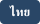

# Kết quả kiểm chứng

<!-- koda-doc-nav -->
<p align="center">
  <a href="verification-results.md"></a>
  <a href="verification-results.ja.md"></a>
  <a href="verification-results.zh.md"></a>
  <a href="verification-results.zh-hant.md"></a>
  <a href="%EA%B2%80%EC%A6%9D%EA%B2%B0%EA%B3%BC.ko.md"></a>
  <a href="verification-results.es.md"></a>
  <a href="verification-results.fr.md"></a>
  <strong>Tiếng Việt</strong>
  <a href="verification-results.pt.md"></a>
  <a href="verification-results.th.md"></a>
  <a href="verification-results.tr.md"></a>
</p>
<p align="center">
  <a href="https://github.com/jhny-kor/KODA-BOM-Kit/releases/tag/v0.1.8"></a>
  <a href="../LICENSE"></a>
</p>
<!-- /koda-doc-nav -->

Bản ghi KODA BOM Kit và các phiên bản trước bao gồm ngày, hàm băm, môi trường, kết quả một phần và phạm vi chưa kiểm tra. Bản phát hành chính thức 0.1.8 xác định gói, checksum và phạm vi. Tệp mới cần bằng chứng thử riêng.

[Phát hành 0.1.8](https://github.com/jhny-kor/KODA-BOM-Kit/releases/tag/v0.1.8)

## 2026-11-21 — tách và hợp nhất

`f0610ca-worktree-00ed83f2acd8` thử `scan --separate-boms`, `bom-split`, `bom-merge`, `domain-bom` trên hai kết quả 0.1.6 đã lưu. So sánh độc lập mọi thành phần/quan hệ, thêm một liên kết giữa hai gốc mỗi lần hợp nhất. Mười cặp ID chứng chỉ Ubuntu là 20 vị trí khác nhau được giữ nguyên. Kết quả không có ID trùng. Linux ARM64 kết hợp bốn BOM quan sát với dữ liệu mẫu OpenAPI, mô hình, SLSA và chế tạo. TCP 18443 thực nối tới Perl và gói của nó. Lược đồ và băm đạt. Chữ ký và bằng chứng hiện trường cần xác minh riêng.

| Bản lưu | Thành phần trước / sau | Quan hệ trước / sau |
|---|---:|---:|
| ubuntu | 158,522 / 158,522 | 18,795,889 / 18,795,890 |
| archive-2 | 31,064 / 31,064 | 42,524 / 42,525 |

## 2026-11-21 — quan hệ vận hành

`f0610ca-worktree-06f22395e26f` tạo lại OBOM từ hai bản thu thập một phần. Socket được đếm theo namespace/tiến trình. Debian ARM64 nối `127.0.0.1:18443/tcp` tới `/usr/bin/perl` và `perl-base`, kiểm tra ba mã linh kiện Redfish, mẫu TLS, hai quan hệ build và 11 checksum. OBOM tạo lại giống từng byte. Năm tài nguyên Kubernetes mẫu nối với ID container đầy đủ đã lưu. Cụm thực, phần cứng và phiên TLS thực ngoài phạm vi.

| Bản lưu | Container | Socket host + container | Gắn gói host + container | Quan hệ đối chiếu |
|---|---:|---:|---:|---:|
| ubuntu | 65 | 101 + 109 | 10 + 66 | 3,250 |
| archive-2 | 0 | 60 + 0 | 51 + 0 | 6,193 |

## 2026-11-21 — 12 sửa lỗi Daybreak

Đã xử lý phát hiện ở KODA-SBOM-Maker `cc86c1b`. Bao gồm cô lập Go, băm đúng luồng giải nén, giới hạn 256 lớp và tái dùng băm, giới hạn chỉ mục ZIP/ZIP64, xác minh whiteout, thư mục đầu ra riêng, chỉ mục/giới hạn đối chiếu thông báo, từ chối Python tối ưu, đọc trong gốc đã xác minh, ID ngắn an toàn, xung đột RPM epoch và duyệt có thể hủy theo lô 256 mục.

Go, vet và kiểm tra phát hành đạt trên macOS ARM64. Go 1.26.11 / Syft 1.57.1 tạo Linux amd64 tĩnh ngoại tuyến. 306 checksum và phép thử CLI/thư mục Debian không mạng đạt. Trước/sau giống nhau về 88 gói, một OS, 20 thiết bị và 15 driver. Cả hai thu thập một phần có lý do. Nền tảng khác được biên dịch chéo, chưa chạy và chưa thử VM mới.

```text
source: src8d8c9fe3e5b3
archive SHA-256: e6add9a97af192684b3939254791adcf4923645e377307344f71c9097bc2ebb3
koda-sbom SHA-256: 64dc47888ef64cea303ab4df4660dd89856eaa15d47cc4b48026b0eed33a3a22
```

## 2026-11-20 — 0.1.7

Linux, Go và vet đạt trong Docker Desktop `7.0.14-linuxkit`. CPU khớp lscpu, đọc 1,736 tùy chọn nhân. Debian có một gói cục bộ không ghi nguồn trong 147. Rocky nhận 167 gói kho và phân biệt cài cục bộ/không ghi. Chín container chạy, 14 dừng, 11 image không dùng tạo 35 SBOM trong khoảng 3 phút 30 giây. Số gói 796, 71, 51 khớp. Overlay2 giữ curl ở lớp ghi và thu busybox không dùng. Container bị xóa mang `not_collected`. x86 thực, systemd, Kubernetes/k3s/Podman/CRI-O và VM mới chưa xác minh.

## 2026-11-19 — 0.1.6

Debian 12 / Linux ARM64 / Docker Desktop `7.0.14-linuxkit` kiểm tra định danh, socket thực, 16 container và năm mô-đun ngoài cây. 735 tệp khoảng 89 MB phát hiện đúng một tệp sửa và một tệp di chuyển/thiếu. RSA-1024 và ECDSA P-384 kiểm tra hạn và khóa yếu, không xuất khóa riêng. Phần cứng, snap/flatpak/conda, một số cấu hình dùng mẫu. RAID/NIC/BMC vật lý, SELinux sản xuất, runtime khác và VM mới chưa thử.

## 2026-11-18 — 0.1.6-dev

Go, vet, tập lệnh hỗ trợ và shell đạt. Linux amd64/ARM64 và kiểm kê cơ bản macOS ARM64 thực đạt lược đồ/checksum. Windows chỉ biên dịch. Kiểm tra tệp bị xóa/thay thế, băm image và quy tắc cục bộ. Tracker cục bộ đọc cả hai CycloneDX. Sản xuất và trình duyệt chưa xác minh. Giữ ý nghĩa 704/811 giấy phép và 107 mã mới. Số checksum thay đổi theo phạm vi.

## Lịch sử 0.1.2–0.1.5

0.1.5 thêm quan hệ pnpm/Maven POM, 0.1.4 thêm tập lệnh thư mục, 0.1.3 thêm giới hạn tệp/thời gian. Đối chiếu băm với `release.json`, `VERIFICATION.json`, `dist/evidence/v0.1.x/final-verification.json` khi được cung cấp. 0.1.2 chạy lại Ubuntu và hai nhân Oracle bằng tệp cuối. Cài máy khách thuê bao và áp dụng bản vá thực ngoài thử nghiệm mẫu.

## 2026-10-29 — triển khai và VM Oracle

68 kiểm tra Linux và vet đạt. uid 65534, dữ liệu/rootfs chỉ đọc, không capability/mạng đã xác minh lược đồ, PURL, canary và lỗi. Container Oracle có RPM 182, Python 5, binary 2. guest syscall ghi không có lần gọi mạng hoặc execve bổ sung. Hai định dạng nhận HTTP 202 tại Tracker SQLite cô lập. Mẫu nhỏ 0.1.0 mất 0.78 giây và RSS cực đại 219,644 KiB.

VM Oracle Linux 8.2 khởi động RHCK/UEK có chữ ký, uname/proc và loop khớp. Mỗi VM có 5,516 thành phần, gồm RPM 186, nhân 2, mô-đun 5,321, Python 5, binary 2. Cây RHCK có 2,478, UEK có 2,843 mô-đun. Lược đồ và năm checksum mỗi VM đạt. Mã 3, thu một phần, context hoàn tất, giữ lý do tệp bảo vệ, liên kết ngoài phạm vi, xung đột OpenSSH và cảnh báo Syft.

| Kernel | Thu thập / tổng giây |
|---|---:|
| RHCK `4.18.0-193.el8.x86_64` | 218.445 / 235.169 |
| UEK `5.4.17-2011.1.2.el8uek.x86_64` | 252.524 / 269.963 |

## Giới hạn bằng chứng

VM ban đầu dùng băm 0.1.0 bên dưới. Bản sau có báo cáo riêng. Máy x86 vật lý, khởi động OS/dịch vụ đầy đủ và vá thực chưa thuộc phạm vi. QEMU guest trace và ptrace nguyên bản có môi trường khác nhau. Thu trực tiếp có thể trộn thời điểm. Chọn thời gian ít thay đổi hoặc snapshot chỉ đọc. Phiên bản gói và không quan sát được không đủ để xác định tác động hay khắc phục CVE.

```text
0.1.0 koda-sbom SHA-256: 98384927a272573b0ecd348a55e76d3700008c9677eb3dea16bb76ed2590724b
```

## Tài liệu

[Chạy trong mạng cô lập và xem kết quả](air-gapped.vi.md) · [Hướng dẫn biên dịch và kiểm chứng](verification.vi.md) · [Kết quả kiểm chứng](verification-results.vi.md)
